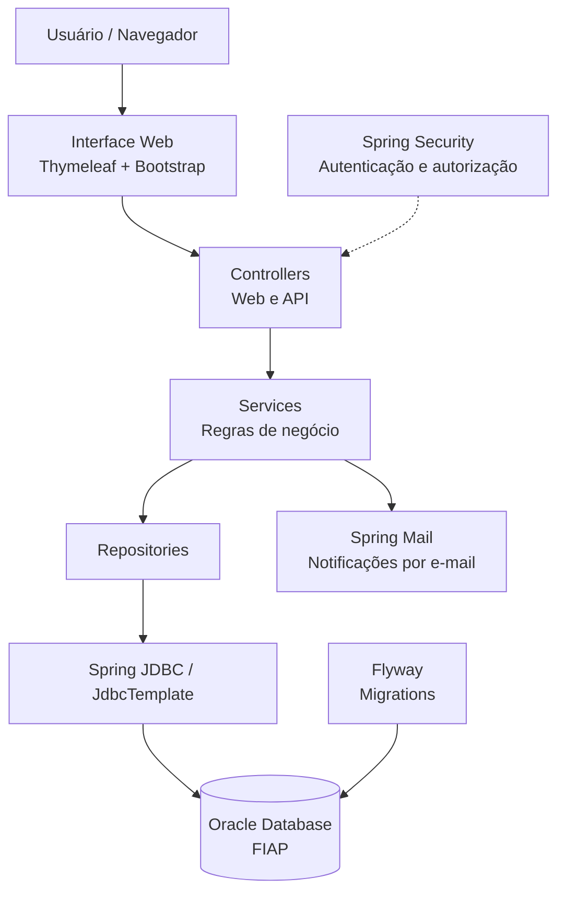
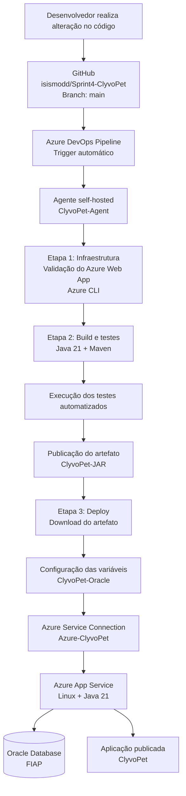

# 🐾 ClyvoPet

Sistema web para gerenciamento de clínica veterinária desenvolvido em **Java com Spring Boot**, com foco no controle de animais, veterinários, consultas e lembretes.

O projeto possui autenticação e autorização por perfil de usuário, persistência em banco de dados Oracle, versionamento do banco com Flyway, validação de dados, envio de notificações por e-mail e deploy em nuvem utilizando Microsoft Azure.

---

## Aplicação publicada

O ClyvoPet está publicado no **Microsoft Azure App Service** e pode ser acessado diretamente pelo navegador:

🔗 [Acessar ClyvoPet](https://clyvopet-rm561497.azurewebsites.net)

> 🔐 As funcionalidades internas do sistema são protegidas por autenticação e exigem login.

---

## Sobre o projeto

O **ClyvoPet** foi desenvolvido para auxiliar no gerenciamento das principais atividades de uma clínica veterinária.

A aplicação centraliza informações relacionadas aos animais atendidos, profissionais veterinários, consultas realizadas e lembretes associados aos atendimentos.

Além das operações de cadastro, consulta, edição e exclusão, o sistema implementa regras de negócio, controle de acesso baseado em perfis, validação dos dados recebidos e envio de notificações por e-mail.

A aplicação possui interface web responsiva desenvolvida com **Thymeleaf e Bootstrap**, integrada ao backend Spring Boot e ao banco de dados Oracle.

---

## Principais funcionalidades

### 🐶 Gerenciamento de animais

O sistema permite realizar o gerenciamento dos animais cadastrados na clínica, incluindo:

- Cadastro de novos animais;
- Visualização dos animais cadastrados;
- Atualização das informações;
- Exclusão de registros;
- Armazenamento dos dados do tutor;
- Visualização de detalhes como espécie, raça, idade, peso, sexo e observações.

### 👩‍⚕️ Gerenciamento de veterinários

Administradores possuem acesso ao gerenciamento dos profissionais veterinários.

Entre as operações disponíveis estão:

- Cadastro de veterinários;
- Consulta dos profissionais cadastrados;
- Atualização de informações;
- Exclusão de veterinários;
- Controle de CRMV;
- Especialidade;
- Telefone e e-mail;
- Controle de perfil de acesso.

A administração dos veterinários é uma funcionalidade exclusiva para usuários com perfil **ADMIN**.

### 📅 Gerenciamento de consultas

O ClyvoPet permite organizar os atendimentos realizados pela clínica.

As consultas relacionam:

- Animal;
- Veterinário responsável;
- Data e horário;
- Motivo da consulta;
- Observações;
- Status do atendimento.

O sistema também possui regras para preservar a consistência das consultas caso um veterinário seja excluído.

Quando necessário, as consultas associadas são canceladas e permanecem registradas no sistema, preservando o histórico do atendimento.

### 🔔 Lembretes

A aplicação possui gerenciamento de lembretes relacionados aos atendimentos veterinários.

Os lembretes auxiliam no acompanhamento das consultas e permitem que informações importantes sejam enviadas aos responsáveis.

### ✉️ Envio de e-mails

O ClyvoPet possui integração com serviço de e-mail utilizando **Spring Mail**.

A funcionalidade permite o envio de notificações relacionadas aos lembretes diretamente pela aplicação.

O serviço utiliza comunicação SMTP autenticada e suas credenciais são armazenadas por meio de variáveis de ambiente no ambiente de produção.

---

## Autenticação e autorização

A segurança da aplicação é implementada utilizando **Spring Security**.

O sistema possui autenticação de usuários e controle de acesso baseado em funções (*roles*).

### 👑 ADMIN

O administrador possui acesso às funcionalidades de:

- Gerenciamento de veterinários;
- Gerenciamento de animais;
- Gerenciamento de consultas;
- Gerenciamento de lembretes;
- Funcionalidades administrativas.

### 👩‍⚕️ VETERINARIO

O usuário veterinário possui acesso às funcionalidades necessárias para operação da clínica, como:

- Animais;
- Consultas;
- Lembretes.

O gerenciamento de outros veterinários permanece restrito ao perfil **ADMIN**.

As rotas protegidas são controladas pelo Spring Security tanto na camada web quanto nos endpoints da aplicação.

---

## Validação de dados

O projeto utiliza **Jakarta Bean Validation** para garantir a integridade dos dados recebidos.

Entre as validações implementadas estão:

- Campos obrigatórios;
- Validação de e-mail;
- Limites de tamanho;
- Valores numéricos positivos ou iguais a zero;
- Validação de dados dos animais;
- Validação de dados dos veterinários.

As mensagens de validação também são apresentadas diretamente nos formulários da interface utilizando integração entre **Thymeleaf, Spring Validation e Bootstrap**.

---

## Banco de dados

O ClyvoPet utiliza **Oracle Database da FIAP** para persistência das informações.

Entre as principais tabelas utilizadas estão:

| Tabela | Responsabilidade |
|---|---|
| `VETERINARIOS` | Armazena os profissionais e usuários do sistema |
| `ANIMAIS` | Armazena os animais e informações dos tutores |
| `CONSULTAS` | Armazena os atendimentos veterinários |
| `LEMBRETES` | Armazena os lembretes relacionados aos atendimentos |

O acesso aos dados é realizado utilizando **Spring JDBC / JdbcTemplate**, com separação entre as camadas de Repository, Service e Controller.

---

## Versionamento do banco com Flyway

O banco de dados é versionado utilizando **Flyway**.

As migrations são executadas automaticamente durante a inicialização da aplicação, permitindo que alterações na estrutura do banco sejam controladas e reproduzidas de maneira organizada.

Exemplos de responsabilidades das migrations utilizadas no projeto:

```text
db/migration/
├── V1__create_table_initial.sql
├── V2__...
└── V3__allow_null_veterinario_consulta.sql
```

As migrations são responsáveis por tarefas como:

- Criação inicial das tabelas;
- Configuração da estrutura do banco;
- Inclusão de dados necessários para inicialização;
- Evolução das regras e relacionamentos entre as entidades.

---

## Arquitetura da aplicação

O projeto utiliza uma arquitetura em camadas para separar as responsabilidades da aplicação.

### Diagrama da arquitetura



A arquitetura também utiliza Spring Security para proteger o acesso às funcionalidades e Spring Mail para o envio de notificações.

---

## 🛠️ Tecnologias utilizadas

### Backend


- Java 21;
- Spring Boot 3.4.1;
- Spring MVC;
- Spring Security;
- Spring JDBC;
- JdbcTemplate;
- Spring HATEOAS;
- Jakarta Validation;
- Spring Mail;
- Maven.

### Frontend


- HTML5;
- CSS3;
- Thymeleaf;
- Bootstrap;
- JavaScript.

### Banco de dados


- Oracle Database;
- Oracle JDBC Driver;
- Flyway;
- HikariCP.

### Cloud e DevOps


- Microsoft Azure App Service;
- Azure DevOps;
- Azure Pipelines;
- GitHub;
- CI/CD;
- Azure Application Insights;
- Azure CLI;
- Agente self-hosted do Azure Pipelines;
- Variáveis de ambiente para gerenciamento de configurações sensíveis.

---

## ☁️ Deploy e CI/CD

A aplicação está hospedada no **Microsoft Azure App Service**, utilizando ambiente Linux com **Java 21**.

O processo de integração contínua e entrega contínua (CI/CD) é realizado pelo **Azure DevOps**, conectado ao repositório GitHub `isismodd/Sprint4-ClyvoPet`, utilizando a branch `main` como origem do código.

A pipeline é executada automaticamente a cada novo commit na branch configurada.

### Azure DevOps — Sprint 4

Foi criada uma pipeline YAML no Azure DevOps, utilizando um agente self-hosted chamado `ClyvoPet-Agent`, configurado em ambiente Windows.

### Diagrama do fluxo CI/CD



### Etapas da pipeline

**1. Infraestrutura**

- Validação da existência do Azure Web App;
- Consulta das informações do recurso utilizando Azure CLI.

**2. Build e testes**

- Verificação da instalação do Java 21;
- Verificação do Maven;
- Compilação do projeto utilizando `mvnw`;
- Execução dos testes automatizados;
- Publicação dos resultados dos testes.

**3. Publicação do artefato**

- Geração do arquivo JAR;
- Preparação dos arquivos de build;
- Publicação do artefato `ClyvoPet-JAR` no Azure DevOps Pipeline Artifacts.

**4. Configuração e deploy**

- Download do artefato gerado;
- Configuração das variáveis de ambiente para conexão com o Oracle;
- Autenticação no Azure utilizando a Service Connection;
- Publicação automática do JAR no Azure App Service.

### Recursos utilizados

| Recurso | Finalidade |
|---|---|
| GitHub | Repositório do código-fonte |
| Azure DevOps Pipelines | Orquestração do CI/CD |
| `ClyvoPet-Agent` | Agente self-hosted |
| Maven | Build e execução dos testes |
| `ClyvoPet-JAR` | Artefato publicado pela pipeline |
| `ClyvoPet-Oracle` | Variable Group com configurações do Oracle |
| `Azure-ClyvoPet` | Service Connection com o Azure |
| Azure App Service | Hospedagem da aplicação |
| Azure Application Insights | Monitoramento da aplicação |

### Segurança das configurações

As credenciais do banco de dados são armazenadas em variáveis protegidas no Azure DevOps, por meio do Variable Group `ClyvoPet-Oracle`.

As configurações são disponibilizadas à aplicação por meio de variáveis de ambiente, evitando a exposição de senhas e informações sensíveis no código-fonte.

### Links do Azure DevOps

- [Organização Azure DevOps](https://dev.azure.com/RM561497)
- [Projeto Sprint 4 – Azure DevOps](https://dev.azure.com/RM561497/Sprint%204%20%E2%80%93%20Azure%20DevOps)
- [Pipeline — histórico de execuções](https://dev.azure.com/RM561497/Sprint%204%20%E2%80%93%20Azure%20DevOps/_build?definitionId=1&_a=summary)

### GitHub Actions

O repositório também possui um workflow do GitHub Actions criado anteriormente para build e deploy no Azure App Service.

Atualmente, esse workflow está **desativado**, pois o processo de CI/CD e deploy da Sprint 4 está sendo realizado pelo Azure DevOps.

### Ambiente de produção

| Configuração | Valor |
|---|---|
| Plataforma | Microsoft Azure |
| Serviço | Azure App Service |
| Sistema operacional | Linux |
| Runtime | Java 21 |
| Banco de dados | Oracle Database da FIAP |
| CI/CD atual | Azure DevOps Pipelines |
| Repositório | GitHub |
| Branch | `main` |
| Monitoramento | Azure Application Insights |

🔗 **Aplicação:** [https://clyvopet-rm561497.azurewebsites.net](https://clyvopet-rm561497.azurewebsites.net)

---

## 📁 Estrutura do projeto

A organização principal do projeto segue a estrutura:

```text
src/
├── main/
│   ├── java/
│   │   └── br/com/fiap/ClyvoPet/
│   │       ├── config/
│   │       ├── controller/
│   │       │   ├── web/
│   │       │   └── api/
│   │       ├── model/
│   │       ├── repository/
│   │       ├── service/
│   │       └── ClyvoPetApplication.java
│   │
│   └── resources/
│       ├── db/
│       │   └── migration/
│       ├── static/
│       │   ├── css/
│       │   └── images/
│       ├── templates/
│       └── application.properties/
│
└── test/
```

Essa separação facilita a manutenção do projeto e mantém as responsabilidades de cada camada organizadas.

---

## Desenvolvimento

Projeto desenvolvido como parte das atividades acadêmicas da **FIAP**, aplicando conceitos de desenvolvimento Java, Spring Boot, banco de dados, segurança, computação em nuvem e práticas de DevOps.

---

<p align="center">
  🐾 <strong>ClyvoPet</strong><br>
  Cuidado, organização e tecnologia para a gestão veterinária.
</p>
